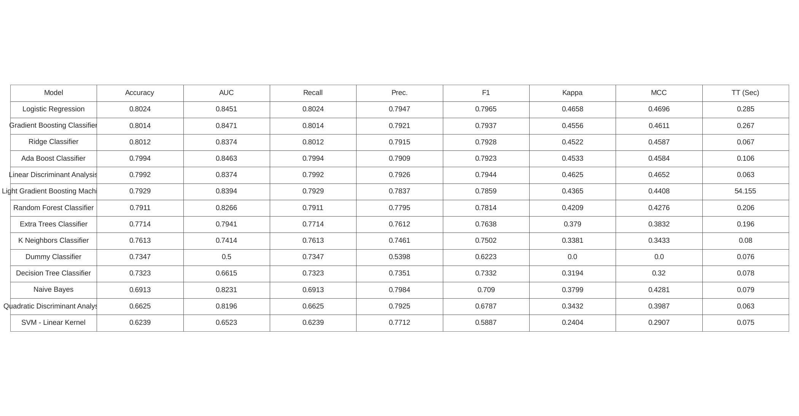
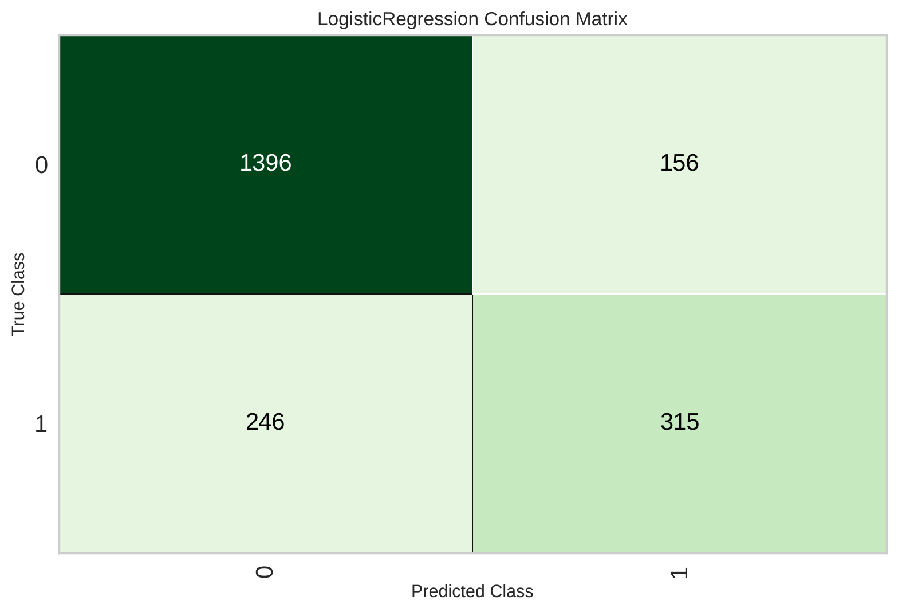
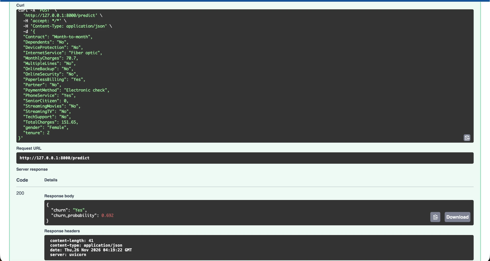
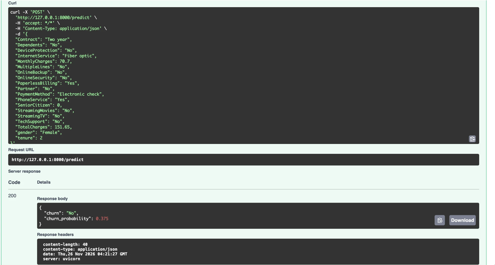

# ML Pipeline: PyCaret vs scikit-learn, served with FastAPI

## Business problem and dataset

A telecom company wants to know which customers are likely to cancel their service (churn), so the retention team can contact them with an offer before they leave.

**Dataset:** [Telco Customer Churn (Kaggle, BlastChar)](https://www.kaggle.com/datasets/blastchar/telco-customer-churn). It has 7,043 customers and 19 features (4 numeric, 15 categorical). The target is `Churn` (Yes/No): 26.5% of customers churned.

- `data/Telco-Customer-Churn.csv` is the original file. It has the same data as Kaggle's `WA_Fn-UseC_-Telco-Customer-Churn.csv`; this copy comes from [IBM's GitHub mirror](https://github.com/IBM/telco-customer-churn-on-icp4d).
- `data/telco_churn_clean.csv` is the cleaned version that `discovery.py` writes.

**Dropped columns:**
- `customerID`: a unique ID for each customer. It carries no information about churn, and the model would only memorize it.

**Cleaning:** `TotalCharges` is stored as text and has 11 blank values. These are new customers with tenure 0. I converted the column to numbers and fill the blanks with the median in the pipeline. I kept `TotalCharges` because, for an existing customer, the total billed so far is known at prediction time.

## How to run

```bash
uv sync
uv run discovery.py            # trains both workflows, writes model.joblib and images/
uv run fastapi dev main.py     # then open http://127.0.0.1:8000/docs
```

## Part 2: Comparing the workflows

### PyCaret
`setup(session_id=42)` and then `compare_models(n_select=3)`. The scores are averages over 10-fold cross-validation on the 70% training split. Top 3: Logistic Regression, Gradient Boosting, Ridge Classifier.



Confusion matrix for the best model (Logistic Regression) on PyCaret's hold-out set. Label 1 = churn:



### scikit-learn
I rebuilt Logistic Regression by hand with the same settings as PyCaret (`max_iter=1000, random_state=42`):
- a stratified 70/30 split
- a `ColumnTransformer` (median imputation + scaling for numeric columns; most-frequent imputation + one-hot encoding for categorical columns)
- one `Pipeline` holding the preprocessing and the model

Results on the 30% test set:

```
              precision    recall  f1-score   support
          No     0.8500    0.8982    0.8734      1552
         Yes     0.6660    0.5615    0.6093       561
    accuracy                         0.8088      2113
weighted avg     0.8011    0.8088    0.8033      2113
```

### Comparison answers

**Efficiency.** PyCaret took far fewer lines to write: 8 lines vs 33 for the scikit-learn pipeline. It also tried 14 models instead of 1. But it was much slower: 433 s on the first run and 563 s on the second, with LightGBM alone taking 41–54 s. The scikit-learn section took 0.1 s because it trains a single model once. PyCaret is the efficient choice for finding a model; scikit-learn is the efficient choice once you know which model you want.

**Why the scores differ.** PyCaret reports the average of 10 cross-validation folds on the training data: accuracy 0.8024, AUC 0.8451. My classification report uses one held-out test set: accuracy 0.8088. A single test split is one sample, so it lands a little above or below the CV average. The preprocessing is also slightly different: I scale numeric columns, and PyCaret doesn't by default. Also, PyCaret's Recall/Prec./F1 columns are **weighted averages over both classes**, which is why its Recall (0.8024) equals its Accuracy. Recall for the churn class alone is much lower: 0.5615 in my report.

**Most important metric.** For this problem I care most about **recall on the churn class**. Missing a customer who is about to leave (a false negative) means losing their monthly bill for good. Flagging someone who would have stayed (a false positive) only costs us a discount or a phone call. My model's churn recall is 0.5615, so it misses about 44% of the customers who actually leave. Accuracy looks good at 0.81, but the model could get 73% just by predicting "No" for everyone, so accuracy isn't a good measure here. To improve recall I would try `class_weight="balanced"` or a lower decision threshold, even if precision drops a bit.

## Part 3: Serving the model

`main.py` loads `model.joblib` once at startup. It defines a Pydantic `Customer` class with one field for each feature, and exposes `POST /predict`.



**Sample input:**
```json
{
  "gender": "Female", "SeniorCitizen": 0, "Partner": "No", "Dependents": "No",
  "tenure": 2, "PhoneService": "Yes", "MultipleLines": "No",
  "InternetService": "Fiber optic", "OnlineSecurity": "No", "OnlineBackup": "No",
  "DeviceProtection": "No", "TechSupport": "No", "StreamingTV": "No",
  "StreamingMovies": "No", "Contract": "Month-to-month", "PaperlessBilling": "Yes",
  "PaymentMethod": "Electronic check", "MonthlyCharges": 70.7, "TotalCharges": 151.65
}
```

**Output:**
```json
{"churn": "Yes", "churn_probability": 0.692}
```

### Explaining a prediction

| Input | Contract | Prediction | Churn probability |
|---|---|---|---|
| 1 | Month-to-month | Yes | 0.692 |
| 2 | Two year | No | 0.375 |

The two inputs are identical except for `Contract`. The second request is shown here:



This makes sense for the business. A customer on a two-year contract is locked in and would have to pay a fee to leave early. Someone who signs for two years is probably already happy with the service. The data agrees: 42.7% of month-to-month customers churned, compared with only 2.8% of two-year customers. The probability is still 0.375 rather than close to 0, because the rest of this customer's profile is risky: only 2 months of tenure, fiber optic and electronic check, which are all linked to higher churn. One caution is that this is correlation, not cause. Moving a customer to a two-year contract won't automatically make them stay, but offering a discount for switching to a longer contract would be a reasonable retention offer to test.

## AI use

I  wrote the scikit-learn pipeline, the FastAPI app and the written answers myself. I used Claude Code (an AI coding assistant) to:
- set up the project and install the packages
- write the PyCaret calls and turn the comparison table into an image
- type the 19 fields of the Pydantic class
- format the README (headings, tables, embedded images)

It also produced the versions of `discovery.py`, `main.py` and the README answers that are in this repo, which I compared against my own work. I chose the dataset, ran and tested the API in `/docs`, took the screenshots and ran the prediction experiment. I split it this way because I wanted to write the core modelling and serving code myself first to learn it, and let the AI handle the repetitive setup and formatting.

One thing that needed correcting: PyCaret's "Recall" column equals its Accuracy (0.8024), which looked like a great recall score. It is actually a weighted average over both classes, which the AI pointed out and I confirmed against the comparison table. The real recall for churners is only 0.56, and that changed my answer about which metric matters. I also checked that the scikit-learn model uses the same settings as PyCaret's best model by printing its parameters.
